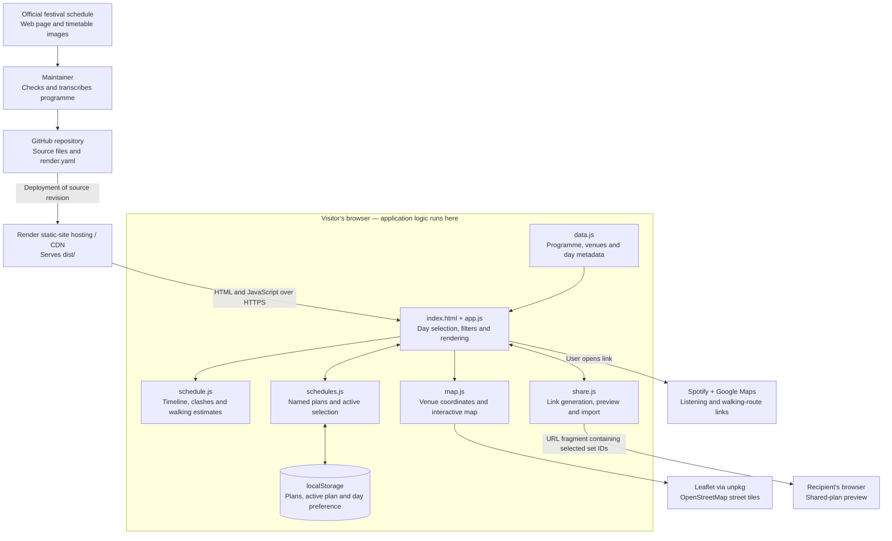

# Mutations Festival guide

An independent, mobile-friendly guide to **Mutations Festival, Brighton, 23–24 October 2026**. Explore the final programme, listen to the artists, find venues and build shareable personal schedules.

**Live app:** https://mutations-festival.onrender.com  
**Official timetable:** https://mutationsfestival.com/schedule

This project is not affiliated with the festival. Entry remains subject to venue capacity.

## Features

- **Friday and Saturday:** switch days across the lineup, map and personal schedule. The programme contains 41 Friday sets across eight venues and 56 Saturday sets across ten venues.
- **Explore the lineup:** group sets by venue or sort by time; search artists and venues; filter by afternoon, evening or late sets.
- **Discover artists:** short listening notes where available, Spotify artist searches and a link to the festival artist list.
- **Venue map:** numbered markers, venue addresses, schedule shortcuts and Google Maps walking directions. Map results follow the current filters.
- **My Schedule:** select individual sets, see time clashes and check the gap and estimated walk between consecutive selections.
- **Multiple named schedules:** create, switch, duplicate, rename and delete plans. Each plan can contain selections from both days. The last remaining schedule cannot be deleted.
- **Mobile layout:** sets and walking cards stack in chronological order without nested card scrolling. Desktop uses a time-scaled timeline with overlapping sets in separate lanes.
- **Sharing:** share the active plan through the device share menu, copy its link, or use a selectable link field when clipboard access is unavailable.
- **Shared-plan previews:** recipients can merge picks into their active plan, save them as a separate schedule, or return to their own selections.

## Using the app

1. Select **Friday** or **Saturday**.
2. Browse or search for artists and tap **＋ My Schedule** beside a set. The star button also toggles selection.
3. Open **My Schedule**. Its top badge counts selected sets across both days of the active plan; the schedule view shows the selected day.
4. Use **Your schedules** to switch plans, or choose **New**, **Duplicate**, **Rename** or **Delete**. New plans start empty; duplicates copy both days' picks.
5. Check the red clash indicators, walking estimates and route links. Overlapping picks represent alternative choices, not a feasible full-set itinerary.
6. Choose **Share My Schedule** to send a snapshot of the active plan's selections from both days.

The same artist can have more than one set. Selections refer to individual performances, so two performances by the same artist can be selected independently.

## High-level architecture



There is **no application backend, database, login or schedule API**. Render serves static assets; the browser performs filtering, timeline layout, clash detection, plan management and link handling. Schedule updates are maintained in the repository rather than fetched from the festival at runtime.

## Project structure

```text
dist/
  index.html     Page structure, styles and controls
  data.js        Final Friday/Saturday programme and day metadata
  map.js         Venue coordinates, Leaflet loading and map interactions
  schedule.js    Timeline layout, clash presentation and walking estimates
  schedules.js   Named-plan management, migration and local persistence
  share.js       Share URLs, preview, import and sharing fallbacks
  app.js         Application state, selection, filtering and rendering
render.yaml      Optional Render Blueprint configuration
README.md        Project documentation
```

Scripts are classic browser scripts with shared state, loaded in the order shown above. Preserve their order in `index.html`: supporting functions are declared before `app.js` initializes the programme, restores plans, processes incoming links and renders the page. There is no bundler or package installation step.

## Run locally

Requirements: a modern browser and, optionally, Python 3 for a local HTTP server.

```sh
git clone https://github.com/JonFlowers/mutations-festival.git
cd mutations-festival
python3 -m http.server 8000 --directory dist
```

Open http://localhost:8000.

Opening `dist/index.html` directly also works for basic browsing. HTTP is preferable for consistent browser storage and sharing behavior. Native sharing and clipboard support depend on browser capabilities, permissions and a secure context; the app provides a manual-copy fallback. Links generated while running locally point to that local origin—use the deployed app to share with other people.

## Programme data and time handling

The final programme comes from the [official schedule page](https://mutationsfestival.com/schedule) and its full-size Friday and Saturday timetable images. The page lists starts; the images also provide ends. The app stores both, enabling full-set clash and transfer checks.

`data.js` defines Saturday venue arrays and Friday sets with the shape:

```js
[start, end, artistName, listeningNote]
// Example:
['15:20', '16:00', 'SNAYX', '...']
```

Venue arrays also carry the venue name, street and description. `festivalDays` supplies dates, opening information and timeline bounds.

- Times are local to Brighton, displayed in 24-hour format.
- After-midnight performances remain assigned to the festival day they follow: Friday's late sets occur early Saturday; Saturday's occur early Sunday.
- The internal minute conversion treats times before 06:00 as belonging after midnight, allowing correct sorting and interval comparisons.
- Clash detection uses overlapping intervals. A set ending exactly when another starts is not a time clash; travelling to another venue can still make that connection too tight.
- Walking comparisons consider consecutive selected sets in start-time order. They do not optimize routes or choose between overlapping selections.

### Updating the programme

1. Check the official page and full-size images for changes.
2. Update set names, venues, starts and ends in `dist/data.js`.
3. Keep matching venue names in `data.js` and `map.js`.
4. Check both days, after-midnight sets, clashes, saved plans and shared links.
5. Commit the source change and deploy it.

**Set identity matters:** Saturday IDs use `venueIndex-setIndex`; Friday IDs use `fri-venueIndex-setIndex`. Saved and shared plans depend on these IDs. Reordering or inserting entries can change what an existing ID means. Preserve IDs when updating existing data, or implement an explicit migration and sharing-format version change before restructuring it. IDs are not currently permanent artist identifiers.

## Storage and migration

Plans are stored in **localStorage on the app's origin**, not on Render or GitHub.

| Key | Purpose |
| --- | --- |
| `mutations26-schedules` | Versioned collection of named plans, their selected set IDs and the active plan ID. |
| `mutations26-saturday` | Compatibility copy of the active plan's selections from both days; also the migration source for the original single-plan app. |
| `mutations26-day` | Last selected festival day. |

The named-plan payload has this shape:

```json
{
  "version": 1,
  "activeId": "default",
  "plans": [
    {
      "id": "default",
      "name": "My Schedule",
      "ids": ["0-0", "fri-0-0"]
    }
  ]
}
```

If no valid named-plan collection exists, the original selections become the default **My Schedule** plan. The collection is written when a plan is saved or changed. Restored IDs are checked against the current programme, and duplicate selections are removed.

Storage is specific to the device, browser and origin. Clearing site data removes plans; private-browsing storage may be temporary. There is no automatic device sync or live multi-user collaboration. If storage cannot be written, the app reports that plans remain available only for the current session.

## Share-link format and behavior

A shared plan is a snapshot in the URL fragment:

```text
https://mutations-festival.onrender.com/#schedule=v1%3A0-0%2Cfri-0-0&day=friday
```

Decoded, `schedule=v1:0-0,fri-0-0` identifies selected performances and `day` chooses the opening day. Actual URLs are generated with `URLSearchParams`.

- Links include selections from both days of the **active plan**, not all named plans.
- Plan names and local plan IDs are not included; imported separate plans initially use the name **Shared schedule** and can be renamed.
- A recipient sees an in-memory preview. Their stored plan is unchanged until they explicitly merge or import the picks.
- **Add these acts to My Schedule** merges into the active plan; **Save as a new schedule** creates an independent plan.
- Later edits do not update links already sent. Share a new link for an updated snapshot.
- Empty plans cannot be shared. Unsupported versions, unavailable set IDs and oversized payloads are rejected; repeated IDs are deduplicated.
- The fragment is handled in the browser and is not sent as part of the HTTP request to the static host. Anyone with the link can view the selections; it is not an access-controlled document.

## Maps, walking estimates and external services

Venue coordinates are stored in `map.js`, checked against festival venue information and OpenStreetMap/Photon results. Locations are approximate; use the walking-route links to check entrances and the actual journey.

For different venues, the walking estimate is:

```text
ceil(straight-line distance in metres × 1.3 ÷ 80) + 2 minutes
```

Distance uses the haversine formula. The factor approximates street layout, the speed is 80 metres/minute, and the extra two minutes allow for exits/entrances. Same-venue transfers are zero minutes.

These are **not routed or live journey times**. They exclude queues and do not account for traffic crossings, crowds, terrain, accessibility needs or individual walking pace. A transfer warning compares the full-set gap against this estimate; check the linked Google Maps walking route before relying on it.

| External service | Use |
| --- | --- |
| unpkg / Leaflet 1.9.4 | Map JavaScript and styles, loaded when the map is opened. |
| OpenStreetMap | Street-map tiles and attribution. |
| Google Fonts | Display fonts, with local font fallbacks. |
| Spotify | Outbound searches for artists; no Spotify authentication or embedded playback. |
| Google Maps | Outbound venue searches and walking routes; no routing API key. |
| Official festival website | Programme source and visitor information links. |

Internet access is needed for these services. If the map library fails, the venue address list and directions links remain available. If tiles fail, the app reports the problem. The app does not request your current location.

## Deployment

The existing production service is a **Render Static Site**:

- Repository: `JonFlowers/mutations-festival`
- Branch: `main`
- Publish directory: `dist`
- Build command: `true` (no compilation needed)
- Production URL: https://mutations-festival.onrender.com

`render.yaml` provides an optional Blueprint with `runtime: static`, an empty build command and `./dist` as the publish path. Its historical resource name is `mutations-saturday`; the existing production service is named `mutations-festival`. The Blueprint is an alternative provisioning path, not an automatic description of all current Dashboard settings. Do not apply it expecting to update the differently named existing service without reviewing the configuration.

For the existing service, push the complete change to GitHub, deploy the intended revision in Render, wait for status **live**, then check the page and changed assets. Updates have been deployed manually in this project. Although the service reports auto-deploy enabled, it was created from a public repository URL; do not assume a push deployed successfully without checking Render's deploy history. Provider-connected Git auto-deployment requires the corresponding Render/GitHub setup.

A README-only change requires no application deployment.

## Validation and maintenance checklist

No build step, package manifest or committed automated test suite is currently included. If Node.js is available, check JavaScript syntax before publishing:

```sh
node --check dist/data.js
node --check dist/map.js
node --check dist/schedule.js
node --check dist/schedules.js
node --check dist/share.js
node --check dist/app.js
```

For behavioral changes, verify:

- Both days show the correct programme and after-midnight ordering.
- Search, venue/time filters and map markers agree.
- Selecting and removing sets updates the active plan and combined-day badge.
- Named plans remain independent after switching and reloading; existing single-plan selections migrate correctly.
- Duplicate, rename and delete work; the last plan cannot be deleted.
- Exact overlaps, back-to-back sets, same-venue transfers and tight walks are labelled correctly.
- Mobile cards have no nested scrolling; desktop overlap lanes remain readable.
- A link with both days' picks opens in a separate browser context as a preview.
- Merge, save-as-new and return-to-own-plan preserve the recipient's existing plans.
- Share-menu, clipboard and manual-copy paths work where supported.
- Names and labels containing punctuation render safely; malformed share links fail gracefully.
- After deployment, the expected commit is live and changed assets are served successfully.

## Current limits

- Programme updates require a source edit and deployment; there is no live festival feed.
- Plans have no account backup, server persistence or automatic cross-device sync.
- Links share snapshots of picks, not live collaborative plans or the entire named-plan library.
- Some artists have only a festival listing note rather than a verified biography.
- Spotify links search for an act and may require choosing the correct result.
- Walking estimates are planning aids rather than verified routes.
- The UI and time handling are specific to the 2026 Brighton festival.
